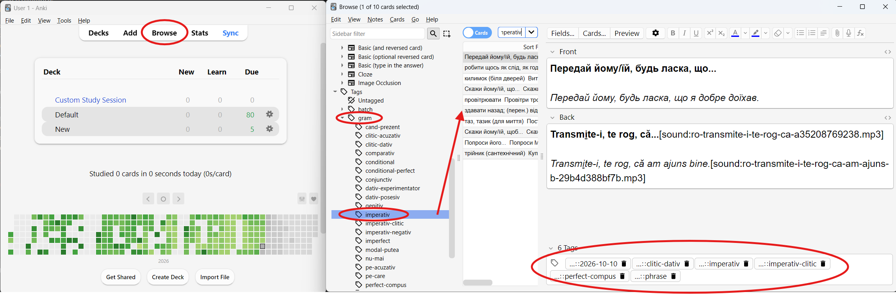
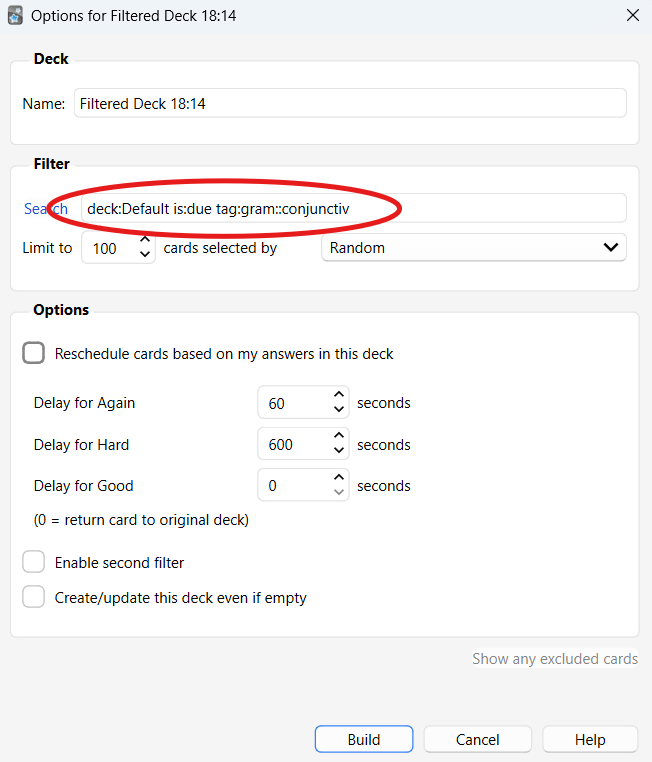

# Romanian flashcards with an AI assistant

Learning Romanian with Anki? Give your AI assistant a few Romanian words, and it makes finished flashcards and puts them straight into your Anki deck. Each card has:

- **a translation:** Ukrainian by default, and other languages work too;
- **a natural example sentence at your level,** using only the grammar you're ready for;
- **the stressed vowel marked;**
- **a native-sounding voice** reading the word and the sentence.

A second, independent AI reviewer checks every example sentence before it reaches your deck. The assistant also skips words you already have cards for.

## What you need

- **A Windows computer** (Windows 10 or 11).
- **Anki**, the free flashcard app: [download Anki](https://apps.ankiweb.net/). The setup helps you install its add-on.
- **An ElevenLabs account** for the voice: [sign up](https://elevenlabs.io/app/sign-up). The setup recommends a Romanian narrator from the ElevenLabs Voice Library, and that voice needs a paid plan ([prices](https://elevenlabs.io/pricing)). The free plan works with ElevenLabs' own voices.
- **An AI assistant:** one of the two below.

You don't need to install anything else. The setup puts a small helper program (Python) inside this folder, and nothing outside it changes.

## Choose your AI assistant

### With Google AI: Antigravity

1. Download and install the **Antigravity app** from [antigravity.google/download](https://antigravity.google/download). Choose the desktop app, not the CLI.
2. Sign in with your Google account.

### With Claude: Claude Code

1. Download and install the **Claude desktop app** from [claude.com/download](https://claude.com/download).
2. Sign in. You'll use its **Code** section, which needs a Claude Pro or Max plan.

## Getting started

1. **Get this folder.** On this page, click the green **Code** button, then **Download ZIP**. Unzip it somewhere easy to find, such as Documents.
2. **Open the folder in your assistant**, as the project or workspace you work in.
3. Type **setup** and press Enter.

The assistant first asks which language you'd like to talk in: Ukrainian, English, or another language. Then it walks you through the rest, one step at a time:
- it installs what's needed inside this folder;
- it helps you connect Anki;
- it opens a settings page in your browser, where you choose your level, the grammar for your sentences, your deck and the voice.

It takes about 15 minutes. At the end you make your first cards together.

## Every day after that

Open Anki, open this folder in your assistant, and write the words you want to learn. For example: *add these words: a merge, o casă, frumos*. Start a new conversation for each batch of words; it keeps costs down.

To change your level, grammar, voice or deck later, type **setup** and say what you'd like to change.

### Find and practise cards by grammar

Every new card gets tags, so you can find cards by the grammar they practise, by word type, or by the day you added them:

| Tag | Example | What it means |
|---|---|---|
| `gram::…` | `gram::conjunctiv` | The card's example uses this grammar. A card can have several. |
| `pos::…` | `pos::verb` | The type of word: verb, noun, adjective, phrase… |
| `batch::…` | `batch::2026-10-30` | The day the card was added. |

In Anki, open **Browse**. Your tags are in the sidebar on the left. Open **gram** to see every grammar point, and click one to list its cards. You can also type a search in the bar at the top:

- `tag:gram::conjunctiv`: cards whose examples use *să* + verb;
- `tag:pos::verb tag:gram::perfect-compus`: verbs with an example in the everyday past;
- `tag:batch::2026-10*`: everything added in October 2026.

**To practise one grammar point on its own:**
1. Choose **Tools → Create Filtered Deck**.
2. Type a search such as `tag:gram::conjunctiv`.
3. Press **Build**.

Anki gathers those cards into a temporary deck. When you're done, delete the filtered deck, and the cards go back to their usual deck.

Every grammar point and its tag is listed in the [grammar table](.agents/skills/add-romanian-words/templates/grammar-profile.seed.md): look up the Construction column, and use the name in its Tag column.

Your own files (your settings, your cards' records and the audio) stay in this folder, in `my-cards/` and `.env`. They are never shared.

## For developers

- **Skills:** the two skills live in `.agents/skills/`: `setup` and `add-romanian-words`. The naturalness reviewer is in `.agents/agents/`. Claude Code reads generated copies in `.claude/`; run `runtime/python/python .agents/skills/add-romanian-words/scripts/adapters.py sync` after editing.
- **Evals:** before and after changing the skill, run the eval suite. See [`.agents/skills/add-romanian-words/evals/README.md`](.agents/skills/add-romanian-words/evals/README.md).

## License

Apache License 2.0; see [LICENSE](LICENSE).
